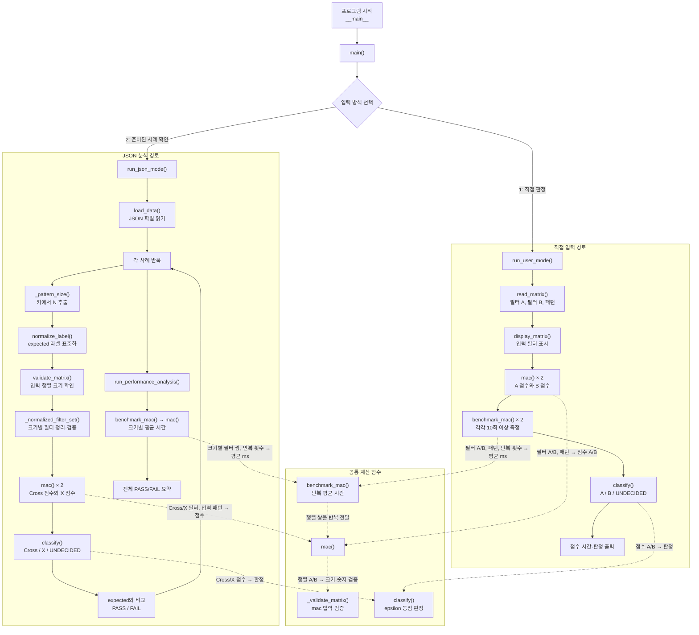

# main.py 호출 구조와 처리 흐름

## 이 도표가 보여 주는 것

이 문서는 `main.py`에서 프로그램이 시작된 뒤 어떤 함수가 호출되고, 입력 방식에 따라 처리가 어떻게 흘러가는지 보여 줍니다. 함수 호출 구조와 처리 순서를 함께 이해하기 위한 흐름도입니다.

유스케이스 다이어그램은 사용자가 할 수 있는 일을 보여 주고, 시퀀스 다이어그램은 시간에 따른 상호작용을 보여 줍니다. 함수 간 호출 관계와 전체 처리 경로를 이해하기 위해 이 문서에서는 흐름도를 사용합니다.

## 전체 흐름도

점선 화살표는 함수 호출을 나타냅니다. 화살표 글자는 호출할 때 전달하는 값과 반환되는 값을 요약합니다. 실선은 프로그램의 큰 처리 순서를 나타냅니다. 즉, 호출 관계와 데이터 전달을 한 그림에서 함께 읽을 수 있습니다.

## 두 경로의 목적

- **직접 입력 경로:** 사용자가 3×3 필터 두 개와 패턴을 입력하고, 프로그램이 두 점수를 비교해 판정합니다. 미리 정해진 정답 라벨은 없습니다.
- **JSON 분석 경로:** `data.json`에 준비된 패턴들을 판정하고, 각 결과를 `expected`와 비교해 PASS/FAIL을 냅니다. 이 경로는 준비된 사례로 동작을 확인하는 평가 흐름입니다.
- 두 경로는 점수 계산에 `mac()`을, 점수 비교와 동점 처리에 `classify()`를 함께 사용합니다.

## 주요 함수 역할

| 함수 | 역할 |
|---|---|
| `main()` | 입력 경로를 선택하고 해당 처리 함수를 호출합니다. |
| `run_user_mode()` | 사용자가 입력한 필터와 패턴을 판정합니다. |
| `run_json_mode()` | JSON 사례를 반복 처리하고 결과를 채점·요약합니다. |
| `mac()` | 같은 위치의 값을 곱해 모두 더한 점수를 계산합니다. |
| `classify()` | 두 점수를 비교하고 epsilon 범위의 차이는 `UNDECIDED`로 처리합니다. |
| `benchmark_mac()` | MAC 호출을 반복해 평균 시간을 계산합니다. |
| `run_performance_analysis()` | 여러 크기의 MAC 실행 시간을 측정해 출력합니다. |

## 비슷한 이름의 행렬 검증 함수

`_validate_matrix()`와 `validate_matrix()`는 서로 다른 함수입니다.

- `_validate_matrix()`는 `mac()`이 계산을 시작하기 전에 두 입력이 같은 크기의 숫자 행렬인지 확인합니다.
- `validate_matrix()`는 JSON 분석에서 입력 패턴이나 필터가 키에 표시된 예상 크기인지 확인합니다.
